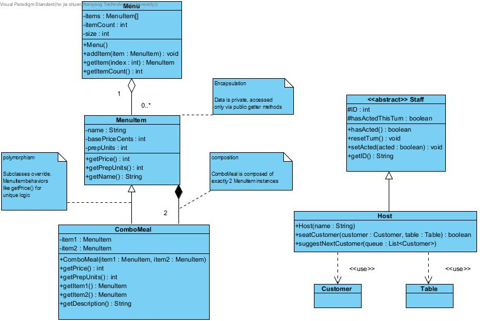
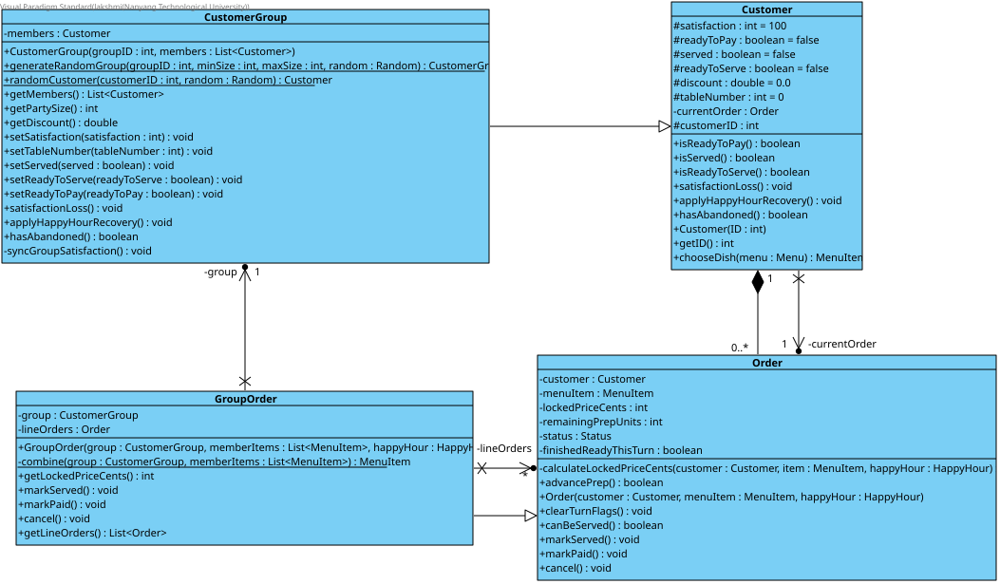

# restaurant-rush

**GitHub Repository Link: https://github.com/juncell/restaurant-rush**

Restaurant Rush is a playable restaurant management game in Java, played across 3 stages. Done as part of SC2002: Object Oriented Programming and Designing Assignment. 

The player's role is the restaurant manager. 

## Table of Contents
1. [How to Play](#how-to-play)
2. [Organisation of Code](#organisation-of-code)
3. [Rules Shared By Every Stage](#rules-shared-by-every-stage)
4. [Key Outcomes](#key-outcomes)
5. [Stage Tags](#stage-tags)
6. [Stage 1: Basic Operation](#stage-1-basic-operation)
7. [Stage 2: Additional Customer Behaviour](#stage-2-additional-customer-behaviour)
8. [Stage 3: New Role and Menu Policy](#stage-3-new-role-and-menu-policy)
4. [Stage 4: Additional Features](#stage-4-additional-features)
5. [UML Class Diagram](#uml-class-diagram)
6. [UML Sequence Diagram](#uml-sequence-diagram)
7. [Video Timestamps](#video-timestamps)
8. [Design Discussion](#design-discussion)
9. [Individual Reflections and Contributions](#individual-reflections-and-contributions)
10. [AI Chat Histories](#ai-chat-histories)

## How to Play 
1. There are test scripts under the folder: `tests`. 
2. Compile the StageNMain.java (N = stage number) file. 
3. If using Eclipse:  
   * For Stage 1 to 3 Victory, Defeat and Invalid Input test scripts:
      - Run Configurations -> Main -> Main class: StageNMain
      - Run Configurations -> Arguments -> Program arguments: tests/test_script_name.txt
      - Apply -> Run  
   * For Stage 4 Victory, Defeat and Invalid Input test scripts: 
      - Run Configurations -> Main -> Main class: Stage4Main.java
      - Run Configurations -> Arguments -> Program arguments: 51
      - Run Configurations -> Common -> Input File: Select Workspace -> retaurant-rush -> tests -> test_script_name.txt
      - Apply -> Run
4. If using Visual Studio Code: 
   * For Stage 1 to 3 Victory, Defeat and Invalid Input test scripts: 
      - java StageNMain.java < tests/test_script_name.txt 
   * For Stage 4 Victory, Defeat and Invalid Input test scripts: 
      - java Stage4Main 51 tests/stage4_victory.txt

Further commands are included in the respective StageNMain.java files for reference. 

## Organisation of Code
All four stages share one set of classes. Each stage has its own entry point, which builds the game for that stage:

| Entry point | Builds | What it turns on |
|---|---|---|
| `Stage1Main` | `new GameManager(ui, 1)` | Regular customers, Salad / Burger / Pasta, Waiter, Chef, Cashier |
| `Stage2Main` | `new GameManager(ui, 2)` | Stage 1 + a VIP (turn 4) and a Critic (turn 10) |
| `Stage3Main` | `new GameManager(ui, 3)` | Stage 2 + Host, ComboMeal items on the menu, Happy Hour |
| `Stage4Main` | `new Stage4GameManager(ui, seed, mixed)` | Extra: random tables and parties (`CustomerGroup`, `GroupTable`, `GroupOrder`) |

`ConsoleUI` is the only class that reads input or prints; the game rules live in the domain classes and the
controllers (`GameManager`, `Stage4GameManager`).

## Rules Shared By Every Stage 
1. There are 18 turns. 
2. 3 staff: waiter, chef, cashier, each doing 1 unit of task per turn. 
3. 2 total tables to seat customers.
4. 1 customer comes in at the start of turns 1, 4, 7, 10, 13, 16. 
5. Goal to succeed: at least 4 paid customers, $45 in revenue, average satisfaction >= 60.

## Key Outcomes

Every game is judged on the same three targets at the end of turn 18: at least **4 paying customers**,
at least **$45.00 revenue**, and an **average satisfaction of at least 60** among paying customers.
Each stage has a victory script and a defeat script with the same customers. Only the manager's
decisions change, and between them the defeats miss each target at least once.

| Stage | Victory (paid, revenue, avg satisfaction) | Defeat (paid, revenue, avg satisfaction) | Why the defeat loses |
|---|---|---|---|
| 1 | 5, $66.00, 79.2 | 0, $0.00, N/A | The staff only wait, so 2 customers walk out and nobody pays |
| 2 | 5, $73.50, 75.6 | 2, $22.50, 87.0 | The Chef never starts a Pasta; both tables stay blocked and the Critic walks out |
| 3 | 5, $91.80, 80.8 | 4, $70.20, 49.8 | No Host or Happy Hour, and slow service: average satisfaction falls below 60 |
| 4 (extra) | 5, $115.44, 66.8 | 4, $85.44, 55.5 | New orders are taken before ready food is served, so customers wait longer |

What each stage adds, as seen in the victory runs:

* **Stage 2:** the VIP loses 5 satisfaction a turn instead of 8 and pays $13.50 for a $15.00 Burger.
  The Critic loses 12 a turn and orders the hardest dish (Pasta). The VIP pays with satisfaction 90,
  the Critic with 52.
* **Stage 3:** the Host seats a customer so the Waiter can take their order in the same turn. Happy Hour
  prices the VIP's Burger at $10.80 ($15.00 less 10%, then less 20%) and lifts the VIP from 95 to 100.
  The Critic's Burger + Pasta Combo costs $29.70 (90% of the two dishes).
* **Stage 4:** a party of three gets its own table and one $39.00 bill. Two single customers share a table.
  A party's satisfaction is the average of its members.

To reproduce these results, see [How to Play](#how-to-play).

## Stage Tags
> Note: 
> Since we completed stages 1 to 3 simultaneously at the same time, we could not commit our stage tags into main. Hence, we decided to tag the stages via a branch `stage-snapshots`. 

Each stage is tagged in GitHub: `stage-1`, `stage-2`, `stage-3`, plus `stage-4` for the extra. The tags are on the
`stage-snapshots` branch, where each commit holds one stage's code only (Stage 1 has no Stage 2 or 3 classes);
`main` holds the final version, including the Stage 4 extra.

To run a tagged version: `git checkout stage-2`, then `javac *.java` and `java Stage2Main`; return with
`git checkout main`.
### Stage 1 --> Stage 2 
Compare: https://github.com/juncell/restaurant-rush/compare/stage-1...stage-2

New files
* `VIPCustomer.java`, `CriticCustomer.java`: the two new customer types.
* `Stage2Main.java`: entry point for Stage 2.
* `tests/stage2_victory.txt`, `tests/stage2_defeat.txt`.

Changed files
* `Customer.java`: adds the `discount` field and `chooseDish(Menu)`, so each customer type can override its own
  discount and food choice.
* `Order.java`: the locked price applies the customer's discount.
* `ArrivalSchedule.java`: makes C2 a VIP and C4 a Critic when Stage 2 is on.
* `GameManager.java`: takes the stage number and asks each customer what it orders (`customer.chooseDish(menu)`).

### Stage 2 --> Stage 3
Compare: https://github.com/juncell/restaurant-rush/compare/stage-2...stage-3

New files
* `Host.java`, `ComboMeal.java`, `HappyHour.java`: the three Stage 3 features.
* `Stage3Main.java`: entry point for Stage 3.
* `tests/stage3_victory.txt`, `tests/stage3_defeat.txt`, `tests/stage3_invalid_input.txt`.

Changed files
* `Menu.java`: adds the three combos when Stage 3 is on (small setup change).
* `Customer.java`: adds `applyHappyHourRecovery()` (+15, up to 100, only while not yet served).
* `Order.java`, `Waiter.java`: an order taken during Happy Hour gets 20% off after the VIP discount.
* `GameManager.java`: adds the Happy Hour question, the Host's turn before the Waiter, and the Happy Hour countdown.
* `ConsoleUI.java`: adds the Host and yes/no prompts and the Happy Hour status.

### Stage 3 --> Stage 4 (additional features)
Compare: https://github.com/juncell/restaurant-rush/compare/stage-3...stage-4

New files
* `Stage4Main.java`, `Stage4GameManager.java`, `Stage4ArrivalSchedule.java`: entry point, controller and random arrivals.
* `CustomerGroup.java`, `GroupOrder.java`, `GroupTable.java`: parties, group orders and shared tables.
* `tests/stage4_victory.txt`, `tests/stage4_defeat.txt`, `tests/stage4_invalid_input.txt`.

Changed files
* `ConsoleUI.java`: the seating map and party labels.
* `Restaurant.java`: a constructor that takes a ready-made list of tables (random sizes).
* `Table.java`: lets `GroupTable` free one seat at a time for shared tables.
* `Host.java`: the two Stage 4 methods (`seatCustomerWithMoraleBoost`, `suggestNextCustomer`).
* `CriticCustomer.java`: a constructor that takes the game's seeded random generator.

Stages 1-3 never create any of the Stage 4 objects.

## Stage 1: Basic Operation
### Specifications 
Base setting. 

### Classes Implemented 
* `Customer`: handles satisfaction decrement, serving, seated and paid status. 
* `Order`: composite class of customer; handles the price, served and payment status. 
* `MenuItem`: handles the price, name and no. of prep units required. 
* `Console UI`: handles how the gaming interface on the terminal looks like. 
* `Staff`: parent class handling name and turn activity. 
* `Restaurant`: handles how the restaurant functions (getting queue, menu, staff operations, etc). 
* `Game Manager`: composite class that handles how the player plays the game (no. of turns, handle staff, play turn, etc). 

## Stage 2: Additional Customer Behaviour 
### Specifications 
1. Implement new customer behaviours (VIP and Critic Customers). 
2. The winning condition and general rule play remains the same. 

### Classes Implemented 
`VIPCustomer` and `CriticCustomer` are extended from the parent `Customer` class. 

**Our `CriticCustomer` behaviour:**
1. A random dish is chosen as the critic's favourite dish from an array of dishes.
2. If that particular dish is ordered in that turn, the critic's satisfaction loss per turn = 15.
3. If that dish is not ordered in that turn, the critic's satisfaction loss per turn = 12. 

## Stage 3: New Role and Menu Policy
### Specifications 
1. Host: either host or waiter can seat the hosts, but host cannot do any other tasks than right. Can only seat 1 customer per turn
2. Combo Meal: made of 2 existing menu items.
3. Happy hour: additional 20% discount and an increment of satisfaction points (rather than decrement).

### Classes Implemented 
* `ComboMeal`: subclasses `MenuItem` overrides `getPrice()` and `getPrepUnits()` using Composite.
* `HappyHour`: provides an additional 20% discount and +15 satisfaction recovery. 
* `Host`: extends the `Staff` class.
* `Menu`: Holds available base items and combos in an array. 

## Stage 4: Additional Features
### Specifications
1. Host: Gives a seated customer an immediate +5 satisfaction boost and suggest who to seat next based on the lowest satisfaction rate.
2. Combo Meal: Avoid making a combo that consist of two of the same items, and format item breakdown with total dollar savings. 
3. Group seating (`Stage4Main` / `Stage4GameManager`): random number of tables (2-4) with random capacities (2-6). Arrivals (same turns as Stages 1-3) are either an individual customer (`C`) or a party (`G`, a `CustomerGroup`).
   * Individuals follow Stage 1-3 rules (own order, own bill) and may share a `GroupTable` with strangers until it is full.

   

   * Parties need an empty table big enough for all members, never share, and place one `GroupOrder`.

   

   * Run `java Stage4Main [seed]` for mixed arrivals, or `java Stage4Main [seed] --groups-only` for parties only.

## UML Class Diagram
This UML class diagram corresponds to Stage 3. 

## UML Sequence Diagram
* This diagram simulates Stage 2 being played, specifically the `stage2_victory.txt`. 
* A helper function, `stage2SequenceDiagramScenario()` was used generate a sequence diagram from Visual Paradigm. 

## Video Timestamps 

## Design Discussion 

### 1. Key Abstractions
- **`Host`**: Manages allocating seats and ensure the availability of table
- **`ComboMeal`**: Extends `MenuItem` give customer a choice to buy combination of items at a discounted price and calculate the total price of the combo 
- **`Customer` (`VIPCustomer`, `CriticCustomer`)**: contains information about the clients and tracks their satisfaction levels. Different customers can implement their own discount systems due to polymorphism. 
- **`Order`**: Tracks the whole order process (`PLACED` $\rightarrow$ `READY` $\rightarrow$ `SERVED` $\rightarrow$ `PAID`).
- **`GameManager`**: supervises the game process by controlling the 18 turns and coordinating the various employee activities. 
- **`HappyHour`**: check whether `HappyHour` is up and applies all the possible discounts for eligible orders. 

### 2. SOLID Principles Highlights
- **SRP & DIP**: Domain classes (`Host`, `ComboMeal`) are strictly decoupled from presentation logic, delegating all UI rendering to `ConsoleUI` instead of hardcoding `System.out.println`.
- **OCP & LSP**: New customer tiers and menu items integrate smoothly into loops via polymorphism without modifying core manager classes.

### 3. Trade-offs & Alternative Designs Considered
The decision that was taken was to separate the game’s logic from its interface. While initially this was not straightforward, as it meant seeing more thought had to go into how the information was passed between the classes instead of just printing things. 

However, this has resulted in the code being much better organised. Code structures and classes could be tested and modified more easily without a need to affect other game components.

### 4. Player Choices & Game Outcomes
- Strategic deployment of the `Host`, purchasing `ComboMeal` items during `HappyHour`, and managing customer tiers directly affect table turnaround times, average satisfaction ($\ge 60$), revenue ($\ge 45.00$), and final victory evaluation (`GameStatistics.isVictory()`).

## Individual Reflections and Contributions 
### Contributions 

| Name | Contributions | 
|:----: | ------------- | 
| Jia Shuen | • Created `Host`, `ComboMeal`, `Menu`, `MenuItem` classes • Additional features: `Host`, `ComboMeal` classes|
|Lakshmi | • Created `Customer` and `Staff` classes (`Customer`, `VIP`, `Critic`, `Staff`, `Chef`, `Waiter`) • `Order`, `Table` classes • Additional features: `CustomerGroup`, `GroupOrder`, `GroupTable`, `Stage4ArrivalSchedule`, `Stage4Main` classes • UML class and sequence diagrams|
| Isaac | • Implemented `GameManager`: the 18-turn game loop, staff turn order and stage-based feature switching • Stage 2 and 3 integration in `GameManager` (customer dish choice, Host turn, Happy Hour prompt and countdown) • Contributed to the UML class diagram|

### Reflections

#### Jia Shuen  
I learnt about object-oriented inheritance and polymorphism by writing `ComboMeal` subclass which inherits from `MenuItem` and overrides the key pricing and prep-unit logic. This is done using inheritance so that `ComboMeal` instances could be plugged straight into the existing arrays of Menu items alongside regular items without rewriting any menu management code. However, preventing floating point precision errors when determining exact cent values for discounted combo meals was difficult. To solve this, I stored all money values as integer cents, rounded to 10% discount with Math.round(), and added validation to not allow duplicate items in a combo. 

#### Lakshmi 
Through this project, I learned how to apply OODP concepts with SOLID principles to keep a growing codebase clean and extensible. 

When designing the `Customer` and `Staff` classes, I actively thought about attribute visibility so that subclasses could reuse behaviour instead of duplicating code (example: protected for shared attributes like `satisfaction` and `hasActedThisTurn` flags, private for constants). Following the Liskov substitution principle, I also ensured that every `Customer` subtype (`VIPCustomer`, `CriticCustomer`, `CustomerGroup`) could be substituted into the same turn flow without `GameManager` needing type checks. In stage 4, I worked on customer groups (families who sit together at one table and wait/leave together while individual customers can share a table). Designing `Customer`, `Order` and `Table` keeping OCP in mind made it easier to extend them into `CustomerGroup`, `GroupOrder` and `GroupTable` without modifying the above parent classes. 

One major challenge was deciding how to model `GroupOrder` — whether a group should place one combined order or multiple seperate orders, whether they should be served together (combined prep units) or one dish at a time and whether they pay as a single unit (just like an individual customer). Managing the orders and payment seperately means it would complicate `Chef` and `Cashier` turn limits. 

To mitigate this, I applied the composite pattern alongside LSP. So, `CustomerGroup` extends `Customer`, `GroupOrder` extends `Order` so the `Waiter`, `Chef` and `Cashier` handle a group just like a single customer with one combined kitchen ticket. Internally, `GroupOrder` contains the individual per-member `Order` line items, which preserves each group member’s own discount (example: if there is a mix of customer types, their respective discount rates will be applied to their orders only), without adding additional branch logic to `GameManager`. 

#### Michell
While I was building the ConsoleUI, I kept refining how the game’s output was being displayed and learnt the importance of small private helper methods for clean and consistent output designs. Instead of repeating formatting code in every screen which was what I did initially, I wrote helpers such as formatMoney(), which turns integer cents into “$24.30”, and formatAverage() which prints “N/A” when nobody has paid. I also tried making label() for names like “C2 (VIP)” and mark() for the [MET]/[NOT MET] checklist which worked out very well in the output console. I also applied features from Topic 10 to make my code look cleaner, such as WaiterAction enum for menu choices. The hardest part for me was the stage tagging. Our group wrote the code in parallel, so our commits did not separate Stage 1, 2 and 3 features. After discussing with my groupmates and asking AI to find possible approaches to do it, we decided to create a new branch and re-add each stage’s classes one stage at a time, tagging each stage once it compiled and its test scripts passed. From this, I learnt that a problem can be solved in various ways and that planning stage boundaries and committing stage by stage from the start would have saved us this reworking.

#### Jishna
Through this group assignment, I gained a better understanding of object-oriented programming principles and how they are applied in developing a functional Java application. Although my main contribution was creating and editing the project demonstration video, I had to familiarise myself with the different game mechanics, class functionalities and overall program flow to ensure that the video accurately represented our implementation. This allowed me to better understand how concepts such as encapsulation, inheritance and polymorphism were used to structure our Restaurant Rush game. One challenge I faced was deciding how to present the different features and technical aspects of our implementation within a limited video duration while ensuring that the demonstration remained clear and engaging. I overcame this by organising the video according to the different game stages, highlighting key functionalities and ensuring that the transitions between demonstrations were coherent. I also learnt the importance of communication and coordination within a team, as producing the final video required consolidating everyone’s contributions into one cohesive presentation. Overall, this assignment taught me that software development involves more than just writing code; effective documentation, presentation and teamwork are equally important in delivering a complete software project.

#### Isaac
Working on `GameManager` taught me how a controller class ties the domain classes together without taking over their responsibilities. `GameManager` runs the 18 turns and decides the order in which the staff act, but the rules themselves stay in the domain classes: a `Waiter` decides whether it can seat or serve, an `Order` tracks its own status, and each `Customer` decides what it orders through `chooseDish(menu)`. Because of this, adding the VIP and Critic in Stage 2 needed almost no change to `GameManager`. It calls the same methods, and polymorphism gives each customer type its own behaviour. Stage 3 was harder, because the Host and Happy Hour changed the order of events within a turn: the Host has to act before the Waiter, and Happy Hour has to be offered at the start of a turn and count down at the end. I learnt to keep one stage number that switches features on, instead of writing separate managers for each stage, so that all three stages run on the same tested loop. Working on the UML class diagram also helped me see the dependencies between classes more clearly, and showed me where `GameManager` was coupled to more classes than it needed to be.

## AI Chat Histories 
- Lakshmi: [view history here](https://github.com/juncell/restaurant-rush/blob/ai-history-lakshmi/chat-01.md) 
- Jia Shuen: [view history here](https://github.com/juncell/restaurant-rush/blob/ai-history-jiashuen/chat-02.md)
- Michell: [view history here](https://github.com/juncell/restaurant-rush/blob/ai-history-michell/chat-03.md)
