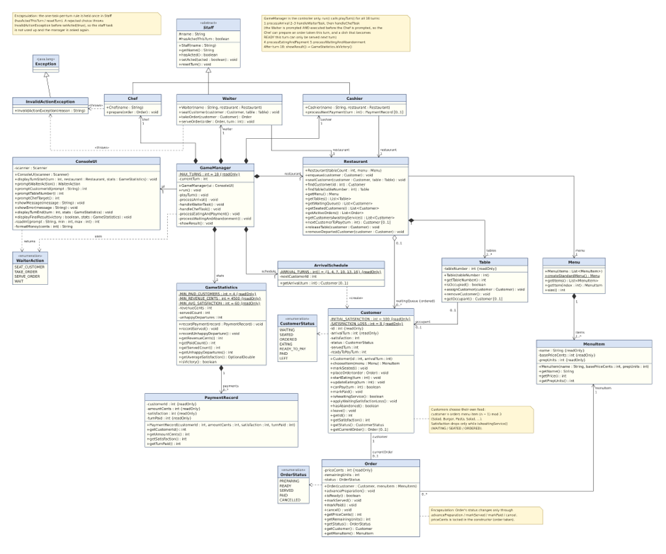

# restaurant-rush
Restaurant Rush is a playable restaurant management game in Java, played across 3 stages. Done as part of SC2002: Object Oriented Programming and Designing Assignment. 

The player's role is the restaurant manager. 

## How to play 
1. There are test scripts under the folder: `tests`. 
2. Compile the StageNMain.java (N = stage number) file. 
3. If using Eclipse: 
4. If using Visual Studio Code: java StageNMain.java < tests/test_script_name.txt 

Further commands are included in the respective StageNMain.java files for reference. 

## Stage 1 
### Specifications 
1. There are 18 turns. 
2. 3 staff: waiter, chef, cashier, each doing 1 unit of task per turn. 
3. 2 total tables to seat customers.
4. 1 customer comes in at the start of turns 1, 4, 7, 10, 13, 16. 
5. Goal to succeed: at least 4 paid customers, $45 in revenue, average satisfaction >= 60.

### Classes implemented 
* `Customer`: handles satisfaction decrement, serving, seated and paid status. 
* `Order`: composite class of customer; handles the price, served and payment status. 
* `MenuItem`: handles the price, name and no. of prep units required. 
* `Console UI`: handles how the gaming interface on the terminal looks like. 
* `Staff`: parent class handling name and turn activity. 
* `Restaurant`: handles how the restaurant functions (getting queue, menu, staff operations, etc). 
* `Game Manager`: composite class that handles how the player plays the game (no. of turns, handle staff, play turn, etc). 

### Sequence diagram 

## Stage 2
### Specifications 
1. Implement new customer behaviours (VIP and Critic Customers). 
2. The winning condition and general rule play remains the same. 

### Classes implemented 
`VIPCustomer` and `CriticCustomer` are extended from the parent `Customer` class. 

### Sequence diagram 

## Stage 3 
### Specifications 
1. Host: either host or waiter can seat the hosts, but host cannot do any other tasks than right. Can only seat 1 customer per turn
2. Combo Meal: made of 2 existing menu items.
3. Happy hour: additional 20% discount and an increment of satisfaction points (rather than decrement).

### Classes implemented 
* `ComboMeal`: subclasses `MenuItem` overrides `getPrice()` and `getPrepUnits()` using Composite.
* `HappyHour`: provides an additional 20% discount and +15 satisfaction recovery. 
* `Host`: extends the `Staff` class.
* `Menu`: Holds available base items and combos in an array. 

### Sequence diagram  

## Stage 4 (additional features implemented)
### Specifications
1. Host: Gives a seated customer an immediate +5 satisfaction boost and suggest who to seat next based on the lowest satisfaction rate.
2. Combo Meal: Avoid making a combo that consist of two of the same items, and format item breakdown with total dollar savings. 
3. Group seating (`Stage4Main` / `Stage4GameManager`): random number of tables (2-4) with random capacities (2-6). Arrivals (same turns as Stages 1-3) are either an individual customer (`C`) or a party (`G`, a `CustomerGroup`).
   * Individuals follow Stage 1-3 rules (own order, own bill) and may share a `GroupTable` with strangers until it is full.
   * Parties need an empty table big enough for all members, never share, and place one `GroupOrder`.
   * Run `java Stage4Main [seed]` for mixed arrivals, or `java Stage4Main [seed] --groups-only` for parties only.

