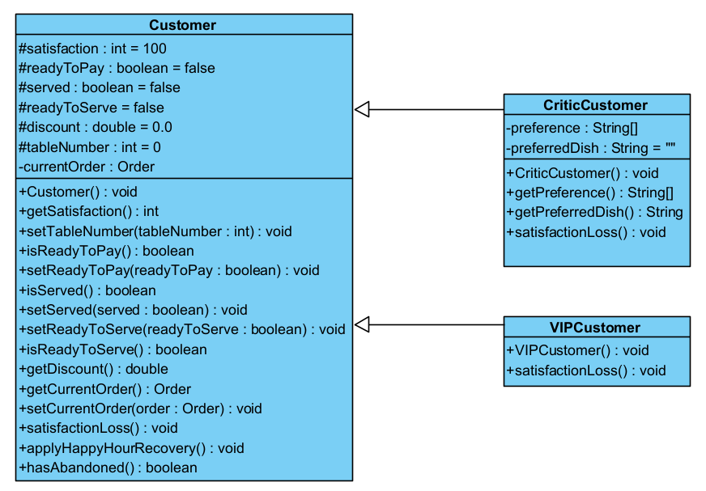
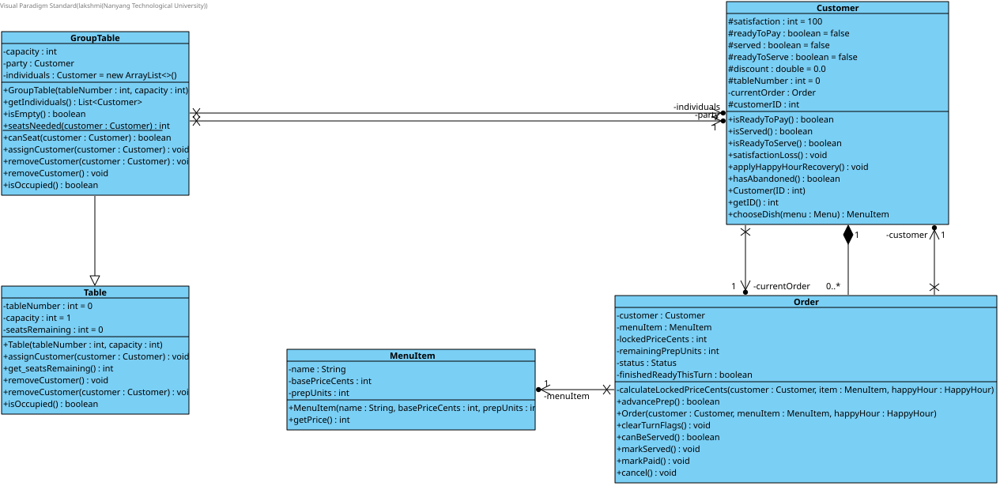
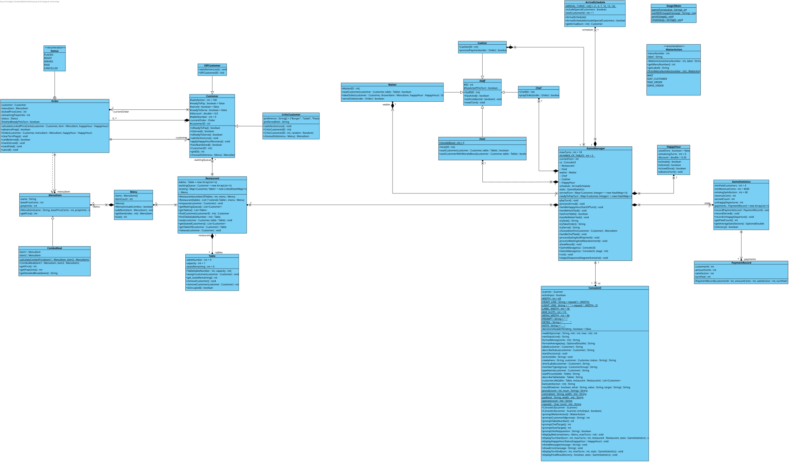
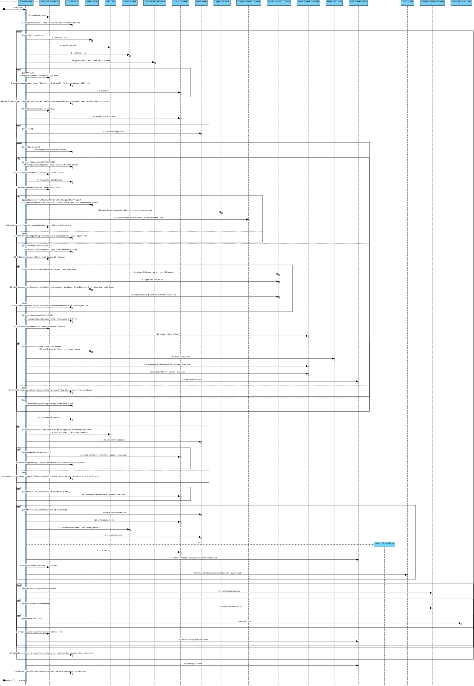

# restaurant-rush

**GitHub Repository Link: https://github.com/juncell/restaurant-rush**

Restaurant Rush is a playable restaurant management game in Java, played across 3 stages. Done as part of SC2002: Object Oriented Programming and Designing Assignment. 

The player's role is the restaurant manager. 

## Table of Contents
1. [How to Play](#how-to-play)
2. [Organisation of Code](#organisation-of-code)
3. [Rules Shared By Every Stage](#rules-shared-by-every-stage)
5. [Stage Tags](#stage-tags)
6. [Stage 1: Basic Operation](#stage-1-basic-operation)
7. [Stage 2: Additional Customer Behaviour](#stage-2-additional-customer-behaviour)
8. [Stage 3: New Role and Menu Policy](#stage-3-new-role-and-menu-policy)
4. [Stage 4: Additional Features](#stage-4-additional-features)
5. [UML Diagram](#uml-diagram)
6. [Sequence Diagram](#sequence-diagram)
7. [Video Timestamps](#video-timestamps)
8. [Design Discussion](#design-discussion)
9. [Individual Reflections and Contributions](#individual-reflections-and-contributions)

## How to Play 
1. There are test scripts under the folder: `tests`. 
2. Compile the StageNMain.java (N = stage number) file. 
3. If using Eclipse:  
   * For Stage 1 to 3 Victory, Defeat and Invalid Input test scripts:
      - Run Configurations -> Main -> Main class: StageNMain
      - Run Configurations -> Arguments -> Program arguments: tests/test_script_name.txt
      - Apply -> Run  
   * For Stage 4 Victory, Defeat and Invalid Input test scripts: 
      - Run Configurations -> Main -> Main class: Stage4Main.java
      - Run Configurations -> Arguments -> Program arguments: 51
      - Run Configurations -> Common -> Input File: Select Workspace -> retaurant-rush -> tests -> test_script_name.txt
      - Apply -> Run
4. If using Visual Studio Code: 
   * For Stage 1 to 3 Victory, Defeat and Invalid Input test scripts: 
      - java StageNMain.java < tests/test_script_name.txt 
   * For Stage 4 Victory, Defeat and Invalid Input test scripts: 
      - java Stage4Main 51 tests/stage4_victory.txt

Further commands are included in the respective StageNMain.java files for reference. 

## Organisation of Code
All four stages share one set of classes. Each stage has its own entry point, which builds the game for that stage:

| Entry point | Builds | What it turns on |
|---|---|---|
| `Stage1Main` | `new GameManager(ui, 1)` | Regular customers, Salad / Burger / Pasta, Waiter, Chef, Cashier |
| `Stage2Main` | `new GameManager(ui, 2)` | Stage 1 + a VIP (turn 4) and a Critic (turn 10) |
| `Stage3Main` | `new GameManager(ui, 3)` | Stage 2 + Host, ComboMeal items on the menu, Happy Hour |
| `Stage4Main` | `new Stage4GameManager(ui, seed, mixed)` | Extra: random tables and parties (`CustomerGroup`, `GroupTable`, `GroupOrder`) |

`ConsoleUI` is the only class that reads input or prints; the game rules live in the domain classes and the
controllers (`GameManager`, `Stage4GameManager`).

## Rules Shared By Every Stage 
1. There are 18 turns. 
2. 3 staff: waiter, chef, cashier, each doing 1 unit of task per turn. 
3. 2 total tables to seat customers.
4. 1 customer comes in at the start of turns 1, 4, 7, 10, 13, 16. 
5. Goal to succeed: at least 4 paid customers, $45 in revenue, average satisfaction >= 60.

## Stage Tags
> Note: 
> Since we completed stages 1 to 3 simultaneously at the same time, we could not commit our stage tags into main. Hence, we decided to tag the stages via a branch `stage-snapshots`. 

Each stage is tagged in GitHub: `stage-1`, `stage-2`, `stage-3`, plus `stage-4` for the extra. The tags are on the
`stage-snapshots` branch, where each commit holds one stage's code only (Stage 1 has no Stage 2 or 3 classes);
`main` holds the final version, including the Stage 4 extra.

To run a tagged version: `git checkout stage-2`, then `javac *.java` and `java Stage2Main`; return with
`git checkout main`.
### Stage 1 --> Stage 2 
Compare: https://github.com/juncell/restaurant-rush/compare/stage-1...stage-2

New files
* `VIPCustomer.java`, `CriticCustomer.java`: the two new customer types.
* `Stage2Main.java`: entry point for Stage 2.
* `tests/stage2_victory.txt`, `tests/stage2_defeat.txt`.

Changed files
* `Customer.java`: adds the `discount` field and `chooseDish(Menu)`, so each customer type can override its own
  discount and food choice.
* `Order.java`: the locked price applies the customer's discount.
* `ArrivalSchedule.java`: makes C2 a VIP and C4 a Critic when Stage 2 is on.
* `GameManager.java`: takes the stage number and asks each customer what it orders (`customer.chooseDish(menu)`).

### Stage 2 --> Stage 3
Compare: https://github.com/juncell/restaurant-rush/compare/stage-2...stage-3

New files
* `Host.java`, `ComboMeal.java`, `HappyHour.java`: the three Stage 3 features.
* `Stage3Main.java`: entry point for Stage 3.
* `tests/stage3_victory.txt`, `tests/stage3_defeat.txt`, `tests/stage3_invalid_input.txt`.

Changed files
* `Menu.java`: adds the three combos when Stage 3 is on (small setup change).
* `Customer.java`: adds `applyHappyHourRecovery()` (+15, up to 100, only while not yet served).
* `Order.java`, `Waiter.java`: an order taken during Happy Hour gets 20% off after the VIP discount.
* `GameManager.java`: adds the Happy Hour question, the Host's turn before the Waiter, and the Happy Hour countdown.
* `ConsoleUI.java`: adds the Host and yes/no prompts and the Happy Hour status.

### Stage 3 --> Stage 4 (additional features)
Compare: https://github.com/juncell/restaurant-rush/compare/stage-3...stage-4

New files
* `Stage4Main.java`, `Stage4GameManager.java`, `Stage4ArrivalSchedule.java`: entry point, controller and random arrivals.
* `CustomerGroup.java`, `GroupOrder.java`, `GroupTable.java`: parties, group orders and shared tables.
* `tests/stage4_victory.txt`, `tests/stage4_defeat.txt`, `tests/stage4_invalid_input.txt`.

Changed files
* `ConsoleUI.java`: the seating map and party labels.
* `Restaurant.java`: a constructor that takes a ready-made list of tables (random sizes).
* `Table.java`: lets `GroupTable` free one seat at a time for shared tables.
* `Host.java`: the two Stage 4 methods (`seatCustomerWithMoraleBoost`, `suggestNextCustomer`).
* `CriticCustomer.java`: a constructor that takes the game's seeded random generator.

Stages 1-3 never create any of the Stage 4 objects.

## Stage 1: Basic Operation
### Specifications 
Base setting. 

### Classes Implemented 
* `Customer`: handles satisfaction decrement, serving, seated and paid status. 
* `Order`: composite class of customer; handles the price, served and payment status. 
* `MenuItem`: handles the price, name and no. of prep units required. 
* `Console UI`: handles how the gaming interface on the terminal looks like. 
* `Staff`: parent class handling name and turn activity. 
* `Restaurant`: handles how the restaurant functions (getting queue, menu, staff operations, etc). 
* `Game Manager`: composite class that handles how the player plays the game (no. of turns, handle staff, play turn, etc). 

## Stage 2: Additional Customer Behaviour 
### Specifications 
1. Implement new customer behaviours (VIP and Critic Customers). 
2. The winning condition and general rule play remains the same. 

### Classes Implemented 
`VIPCustomer` and `CriticCustomer` are extended from the parent `Customer` class. 

## Stage 3: New Role and Menu Policy
### Specifications 
1. Host: either host or waiter can seat the hosts, but host cannot do any other tasks than right. Can only seat 1 customer per turn
2. Combo Meal: made of 2 existing menu items.
3. Happy hour: additional 20% discount and an increment of satisfaction points (rather than decrement).

### Classes Implemented 
* `ComboMeal`: subclasses `MenuItem` overrides `getPrice()` and `getPrepUnits()` using Composite.
* `HappyHour`: provides an additional 20% discount and +15 satisfaction recovery. 
* `Host`: extends the `Staff` class.
* `Menu`: Holds available base items and combos in an array. 

## Stage 4: Additional Features
### Specifications
1. Host: Gives a seated customer an immediate +5 satisfaction boost and suggest who to seat next based on the lowest satisfaction rate.
2. Combo Meal: Avoid making a combo that consist of two of the same items, and format item breakdown with total dollar savings. 
3. Group seating (`Stage4Main` / `Stage4GameManager`): random number of tables (2-4) with random capacities (2-6). Arrivals (same turns as Stages 1-3) are either an individual customer (`C`) or a party (`G`, a `CustomerGroup`).
   * Individuals follow Stage 1-3 rules (own order, own bill) and may share a `GroupTable` with strangers until it is full.

   

   * Parties need an empty table big enough for all members, never share, and place one `GroupOrder`.

   

   * Run `java Stage4Main [seed]` for mixed arrivals, or `java Stage4Main [seed] --groups-only` for parties only.

## UML Diagram
This UML diagram corresponds to Stage 3. 

## Sequence Diagram
* This diagram simulates Stage 2 being played, specifically the `stage2_victory.txt`. 
* A helper function, `stage2SequenceDiagramScenario()` was used generate a sequence diagram from Visual Paradigm. 

## Video Timestamps 

## Design Discussion 

### 1. Key Abstractions
- **`Host`**: Manages allocating seats and ensure the availability of table
- **`ComboMeal`**: Extends `MenuItem` give customer a choice to buy combination of items at a discounted price and calculate the total price of the combo 
- **`Customer` (`VIPCustomer`, `CriticCustomer`)**: contains information about the clients and tracks their satisfaction levels. Different customers can implement their own discount systems due to polymorphism. 
- **`Order`**: Tracks the whole order process (`PLACED` $\rightarrow$ `READY` $\rightarrow$ `SERVED` $\rightarrow$ `PAID`).
- **`GameManager`**: supervises the game process by controlling the 18 turns and coordinating the various employee activities. 
- **`HappyHour`**: check whether `HappyHour` is up and applies all the possible discounts for eligible orders. 

### 2. SOLID Principles Highlights
- **SRP & DIP**: Domain classes (`Host`, `ComboMeal`) are strictly decoupled from presentation logic, delegating all UI rendering to `ConsoleUI` instead of hardcoding `System.out.println`.
- **OCP & LSP**: New customer tiers and menu items integrate smoothly into loops via polymorphism without modifying core manager classes.

### 3. Trade-offs & Alternative Designs Considered
The decision that was taken was to separate the game’s logic from its interface. While initially this was not straightforward, as it meant seeing more thought had to go into how the information was passed between the classes instead of just printing things. 

However, this has resulted in the code being much better organised. Code structures and classes could be tested and modified more easily without a need to affect other game components.

### 4. Player Choices & Game Outcomes
- Strategic deployment of the `Host`, purchasing `ComboMeal` items during `HappyHour`, and managing customer tiers directly affect table turnaround times, average satisfaction ($\ge 60$), revenue ($\ge 45.00$), and final victory evaluation (`GameStatistics.isVictory()`).

## Individual Reflections and Contributions 
### Contributions 

| Name | Contributions | 
|:----: | ------------- | 
| Jia Shuen | • Created `Host`, `ComboMeal`, `Menu`, `MenuItem` classes • Additional features: `Host`, `ComboMeal` classes|
|Lakshmi | • Created `Customer` and `Staff` classes (`Customer`, `VIP`, `Critic`, `Staff`, `Chef`, `Waiter`) • `Order`, `Table` classes • Additional features: `CustomerGroup`, `GroupOrder`, `GroupTable`, `Stage4ArrivalSchedule`, `Stage4Main` classes • UML and sequence diagrams|

### Reflections

#### Jia Shuen  
I learnt about object-oriented inheritance and polymorphism by writing `ComboMeal` subclass which inherits from `MenuItem` and overrides the key pricing and prep-unit logic. This is done using inheritance so that `ComboMeal` instances could be plugged straight into the existing arrays of Menu items alongside regular items without rewriting any menu management code. However, preventing floating point precision errors when determining exact cent values for discounted combo meals was difficult. To solve this, I stored all money values as integer cents, rounded to 10% discount with Math.round(), and added validation to not allow duplicate items in a combo. 

#### Lakshmi 
I was able to apply OODP design rules and SOLID principles when designing my classes. For the customer classes, I had to ensure that the various `Customer` classes were replaceable without affecting the game flow. I was also actively thinking about setting the right visibility for the various attributes in parent classes like `Customer` and `Staff` to allow a more efficient design without repeating code. I worked on implementing customer groups (such as families who either sit together or wait), handling group order and seating groups together on a table (while individual customers can share the table with anyone else). This made me think about extensibility when designing the `Customer`, `Order` and `Table` classes so that they could be easily extended to `CustomerGroup`, `GroupOrder`, and `TableOrder` without adding too much code. 
